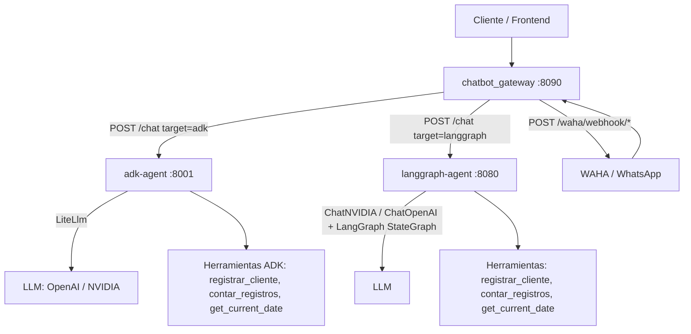

# langchain-testing

Campo de pruebas de arquitectura multi-agente con tres microservicios: un agente de ventas basado en ADK, un agente LangGraph y un gateway de chatbot que enruta peticiones entre ellos. Todo orquestado con Docker Compose.

[](https://python.org)
[](https://www.langchain.com/)
[](https://www.docker.com/)
[](https://github.com/bi0punk/langchain-testing/actions)
[](LICENSE)

## Contenido

- [Características](#características)
- [Arquitectura](#arquitectura)
- [Stack](#stack)
- [Estructura del repositorio](#estructura-del-repositorio)
- [Servicios](#servicios)
- [Instalación](#instalación)
- [Uso](#uso)
- [Configuración](#configuración)
- [Seguridad](#seguridad)
- [Tests / CI](#tests--ci)
- [Roadmap](#roadmap)
- [Licencia](#licencia)

## Características

- Tres microservicios independientes con agentes de IA
- ADK Agent: agente de ventas conversacional (`sales_agent`)
- LangGraph Agent: agente con flujo de grafo basado en LangGraph y herramientas (registrar cliente, contar registros, fecha actual)
- Chatbot Gateway: router inteligente entre agentes (chat directo y webhooks WAHA para WhatsApp)
- Proveedores de LLM configurables: OpenAI (`gpt-4o-mini`) o NVIDIA (`llama-4-maverick`)
- Comunicación entre servicios via red Docker interna
- CORS restringido (no wildcard) para desarrollo local
- Include la carpeta `legacy/` con un prototipo anterior archivado (app Flask estilo antiguo, no activo)

## Arquitectura



Flujo: el gateway centraliza las peticiones y enruta a `adk-agent` o `langgraph-agent` según el target; ambos agentes exponen sus flujos conversacionales y el gateway también recibe webhooks de WAHA para responder en WhatsApp.

## Stack

| Componente | Tecnología |
|---|---|
| Lenguaje | Python 3.11+ |
| Gateway | FastAPI + httpx + WAHA mapper |
| Agente ADK | google-adk + litellm |
| Agente LangGraph | langgraph + langchain_openai + langchain-nvidia-ai-endpoints |
| Orquestación | Docker Compose |

## Estructura del repositorio

```
langchain-testing/
├── adk-agent/              # Agente de ventas ADK
│   ├── Dockerfile
│   ├── requirements.txt
│   ├── main.py
│   └── sales_agent/        # agent.py, tools.py, prompts.py
├── langgraph-agent/        # Agente LangGraph
│   ├── Dockerfile
│   ├── requirements.txt
│   └── src/ (agent, controller, service, llm, routes)
├── chatbot_gateway/        # Gateway router (+ webhooks WAHA)
│   ├── Dockerfile
│   ├── requirements.txt
│   └── src/ (routes, mapper, entities, static)
├── legacy/                 # Prototipo anterior archivado (no activo)
├── docker-compose.yml
├── tests/
├── pyproject.toml
├── .env.example
├── .github/workflows/ci.yml
└── README.md
```

## Servicios

| Servicio | Puerto | Descripción |
|---|---|---|
| `adk-agent` | 8001 | Agente de ventas ADK |
| `langgraph-agent` | 8080 | Agente LangGraph |
| `chatbot_gateway` | 8090 | Gateway router entre agentes |

## Instalación

Requisitos: Docker Engine 24+, Docker Compose v2 y API keys para LLMs (OpenAI, NVIDIA).

```bash
git clone https://github.com/bi0punk/langchain-testing.git
cd langchain-testing
cp .env.example .env
# Editar .env con API keys
```

## Uso

```bash
docker compose up --build
```

Los servicios se inician y el gateway centraliza las peticiones en `http://localhost:8090`.

## Configuración

| Variable | Default | Descripción |
|---|---|---|
| `ALLOW_ORIGINS` | `http://localhost:8090` | Orígenes CORS permitidos |
| `ADK_AGENT_URL` | `http://adk-agent:8001` | URL interna del agente ADK |
| `LANGGRAPH_AGENT_URL` | `http://langgraph-agent:8080` | URL interna del agente LangGraph |
| `OPENAI_API_KEY` | — | API key de OpenAI |
| `NVIDIA_API_KEY` | — | API key de NVIDIA |
| `MODEL_PROVIDER` | `openai` | Proveedor de LLM (`openai` / `nvidia`) |
| `GOOGLE_SHEETS_SPREADSHEET_ID` | — | ID de hoja de cálculo (herramientas) |
| `GOOGLE_CREDENTIALS_FILE` | `credentials.json` | Credenciales Google |

## Seguridad

- CORS origins restringidos (no wildcard)
- Servicios se comunican sobre red interna Docker bridge
- Los puertos individuales de agentes no se exponen externamente

## Tests / CI

CI: GitHub Actions ejecuta ruff lint + pytest en cada push y PR.

```bash
docker compose run --rm chatbot_gateway pytest
docker compose run --rm adk-agent pytest
docker compose run --rm langgraph-agent pytest
```

## Roadmap

- [x] Gateway multi-agente (ADK + LangGraph) + webhooks WAHA
- [ ] Añadir más agentes (RAG, herramientas externas)
- [ ] Autenticación entre servicios (API keys)
- [ ] Monitoreo con tracing distribuido (LangSmith)
- [ ] Despliegue en Kubernetes

## Licencia

MIT — ver [LICENSE](LICENSE).